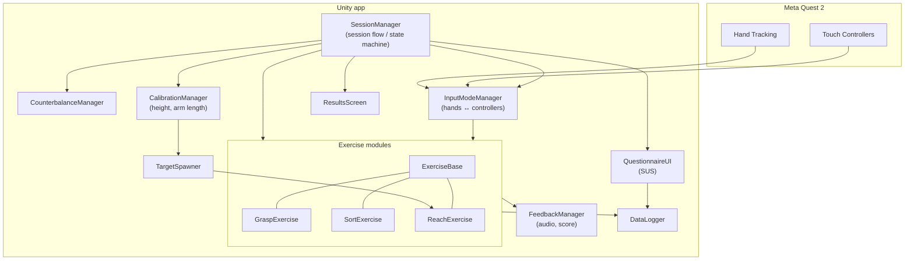

**Hands vs. Controllers in Upper-Limb Rehabilitation** — a Meta Quest 2 VR app that runs the same upper-limb rehabilitation exercises once with bare hands (hand tracking) and once with controllers, in counterbalanced order, and compares accuracy, movement smoothness, repetitions, SUS score and user preference.

📄 **State of the Art document:** [Upper-limb rehab - State of The Art](https://docs.google.com/document/d/1BBVZG78lDgmgTwESydYuQSKIa57uikb0M7RVBRZt4mA/edit?usp=sharing)

**Team:** `Pirvan Ana-Maria` · `Leonte Luca` · `Zuzu Laura-Ioana` · `Tofan Anastasia Maria`

---

## Component diagram

## Main components

| Component | Responsibility |
| --- | --- |
| **SessionManager** | Drives the whole session: calibration → mode 1 → mode 2 → preference → results → exit. Implemented as a simple state machine. |
| **CounterbalanceManager** | Assigns each participant to group A (hands first) or B (controllers first) so order effects cancel out. |
| **CalibrationManager** | Measures the participant's height and arm length at the start, so targets are placed at relative distances. |
| **InputModeManager** | Switches between hand tracking and controllers at runtime by enabling/disabling the matching Meta XR Interaction SDK interactors. |
| **ExerciseBase** | Shared logic for all exercises: start/stop, repetition counting, timing, sending events to the logger and feedback. |
| **GraspExercise** | Pick up objects of different shapes and sizes. |
| **SortExercise** | Place objects into containers by color or shape. |
| **ReachExercise** | Touch targets at three distances; uses **TargetSpawner** to position them from calibration data. |
| **FeedbackManager** | Sound and score on every successful repetition. |
| **QuestionnaireUI** | In-VR SUS questionnaire after each mode. |
| **DataLogger** | Records hand/controller position each frame and every exercise event (accuracy = distance to target, time per repetition, repetitions), plus SUS answers. |
| **ResultsScreen** | Shows a summary of both modes at the end of the session. |
| **Analysis scripts** (Python) | Compute movement smoothness (SPARC / normalized jerk) from trajectories and compare the two modes. |
